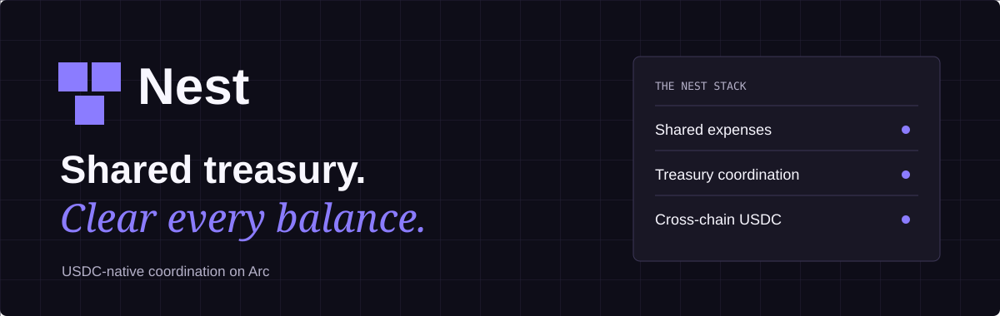
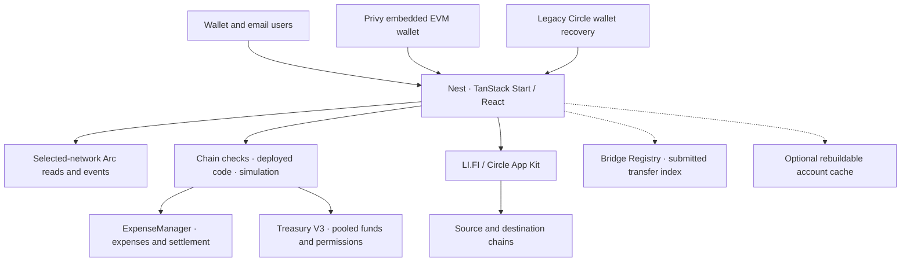

<div align="center">



<br>

**[Live App](https://nestarc.xyz)** · **[Docs](https://docs.nestarc.xyz/)** · **[The Product](#the-product)** · **[Architecture](#architecture)** · **[Quickstart](#quickstart)** · **[Contracts](#deployed-contracts)**

<br>

[](https://docs.arc.io)
[](./contracts/ExpenseManager.sol)
[](./src/routes)
[](./package.json)
[](./contracts)
[](./docs/arc-production-audit.md)

</div>

<br>

> Shared money should come with a shared picture. **Nest brings expenses, USDC settlement and treasury coordination into one Arc-native workspace** — with wallet-owned accounts, onchain financial state and transaction-linked receipts.

The original household ledger stays intact. A separate treasury layer extends Nest to teams, collectives and project groups without silently migrating existing rooms.

**Read the status before using real funds:** Mainnet ExpenseManager code and reads have been checked; funded Mainnet flows remain unverified. Treasury V3 and Bridge Registry have Testnet deployments, but no configured Mainnet deployments. Nest is **not production-certified or independently audited**.

---

## The Product

| Shared expenses | Treasury coordination | Cross-chain USDC |
| :--- | :--- | :--- |
| Rooms, wallet invitations and member shares | Pooled deposits and payment proposals | LI.FI routing and Circle App Kit |
| Equal or custom expense allocations | Manager approval thresholds | CCTP/native-USDC routes where available |
| Net balances and counterparty settlement | Recurring payouts, milestones and budgets | Source and destination delivery evidence |
| **ExpenseManager · both Arc networks** | **Treasury V3 · Testnet deployment** | **Provider-dependent routes** |

### Shared expenses — a ledger everyone can inspect

Create a room, invite wallet addresses and record who paid what. ExpenseManager stores members, obligations, shares and settlement activity on Arc. `settleWith` clears open shares owed to one counterparty; approved USDC moves from the caller to the expense payer rather than entering a pooled Nest balance.

- Equal or custom member allocations.
- Onchain net positions and settlement events.
- Network-tagged invitations; legacy invitations resolve only to Testnet.
- Transaction-linked receipts and selected-network explorer links.

**Source:** [`contracts/ExpenseManager.sol`](./contracts/ExpenseManager.sol) · [`src/lib/chain`](./src/lib/chain)

### Treasury — pooled funds with explicit permissions

Treasury V3 adds shared deposits, N-of-M payment proposals, recurring payouts, milestone escrow and revocable member budgets. It is separate from the legacy expense ledger.

**Important governance limits:** the owner can withdraw available funds through an emergency path; individual managers can create recurring payments and budget policies; historical approvals require governance review. These controls are not a promise that every outflow requires multiple approvals. Recurring execution needs a caller, not an autonomous timer.

**Source:** [`contracts/NestTreasuryV3.sol`](./contracts/NestTreasuryV3.sol) · [`src/routes/app.treasury.tsx`](./src/routes/app.treasury.tsx)

### Bridge — delivery, not just a source transaction

Nest integrates LI.FI and Circle App Kit for supported USDC routes. Quotes are checked against the requested chains, tokens and amount. Refunded, partial, pending and approval-only outcomes must not become completed receipts.

Circle results require successful burn and mint evidence; LI.FI completion requires a completed destination transfer. Availability depends on the provider, selected environment and chain pair — there is no guarantee that every chain or displayed token can be bridged.

Bridge history is wallet- and environment-scoped. NestBridgeRegistry stores caller-submitted transfer metadata; **it does not independently prove execution on another chain**. Historic registry entries are not independently certified delivery evidence.

**Source:** [`src/lib/lifi.ts`](./src/lib/lifi.ts) · [`src/lib/circle-bridge.ts`](./src/lib/circle-bridge.ts) · [`contracts/NestBridgeRegistry.sol`](./contracts/NestBridgeRegistry.sol)

### Accounts — connect a wallet or continue with email

External wallets connect through RainbowKit/Wagmi. New email sign-ins authenticate with **Privy**, creating or restoring an embedded EVM wallet directly. Legacy Circle wallet recovery remains separate to preserve older identities.

Real OTP completion, restoration and authenticated financial flows still require end-to-end acceptance checks. Installing a wallet SDK does not establish that hosted provider settings are correct.

---

## Architecture



**The state rule:** Arc contract state and transaction events are the financial ledger. Optional Lovable Cloud account caches improve loading and cross-device continuity; they do not hold wallet private keys or replace onchain balances. A bridge index row is not a substitute for source and destination execution evidence.

| Layer | Technology |
| :--- | :--- |
| Application | TanStack Start v1, TanStack Router, React 19, TypeScript |
| Interface | Tailwind CSS 4, Radix UI, Lucide |
| Wallet connections | Wagmi, Viem, RainbowKit |
| Email wallet | Privy; separate legacy Circle path |
| Bridge transport | Circle App Kit, CCTP-preferred routes, LI.FI |
| Contracts | Solidity; ExpenseManager verification uses solc 0.8.28 |
| Tooling | Vite, Bun, ESLint, Solidity test suites |

## Repository Map

```text
Nest/
├── contracts/             Solidity ledgers, treasury and registry
├── src/
│   ├── routes/            Landing, app screens and server routes
│   ├── components/        Nest interface and wallet bridges
│   ├── lib/               Chain reads/writes, bridge and safety policies
│   └── integrations/      Generated service integrations
├── scripts/               Deployment, verification and read-only audit
├── test/contracts/        Solidity contract tests
├── docs/                  Production audit and deployment handoff
└── .github/workflows/     Operator-triggered deployment workflow
```

---

## Quickstart

**Use Nest:** open [nestarc.xyz](https://nestarc.xyz), connect a wallet or continue with email, and choose the intended Arc environment. Start with **Testnet**; its assets have no real-world monetary value.

### Run locally

From a checkout of this repository:

```bash
bun install
bun run dev
```

Use the local URL printed by Vite. Wallet providers and optional services need their own configuration; never commit private keys or server credentials. The full network/deployment configuration is in the [deployment handoff](./docs/arc-mainnet-deployment.md).

<details>
<summary><b>Safety regression tests</b></summary>

```bash
bun test src/lib/chain/*.test.js \
  src/lib/lifi.test.js \
  src/lib/bridge-history-scope.test.js \
  src/lib/circle-bridge.test.js \
  src/lib/gasless-policy.test.js \
  src/lib/privy-wallet-policy.test.js \
  src/lib/docs-domain.test.js
```

The 2026-11-20 audit recorded **34 passing tests across 9 files**. This covers selected safety rules, not every wallet, contract or funded transfer. Solidity suites live in `test/contracts` and require their own compatible toolchain and execution.

</details>

<details>
<summary><b>Read-only network audit</b></summary>

```bash
bun scripts/audit-arc-networks.mjs
```

Checks chain identity, deployed code, USDC decimals and selected contract reads. It does not sign, deploy or move funds. Missing Mainnet Treasury/Registry configuration produces a non-zero exit instead of a readiness claim.

</details>

<details>
<summary><b>Deployment and verification</b></summary>

Follow the [Mainnet deployment instructions](./docs/arc-mainnet-deployment.md). The workflow deliberately skips redeploying ExpenseManager unless an operator explicitly requests a replacement. **A replacement does not migrate old rooms.**

Server-side sponsor keys must be separate from the deployment key. Keep Mainnet sponsorship disabled until recipient/value/gas policies, operational controls and funded acceptance checks are in place.

</details>

---

## Deployed Contracts

Addresses below reflect the [read-only audit on 2026-11-20](./docs/arc-production-audit.md). Code presence and successful reads are not an independent security audit or verification of funded writes.

### Arc Mainnet · `5042`

| Contract | Address | Status |
| :--- | :--- | :--- |
| ExpenseManager | [`0x709cbad88162b999882788155cde79ade46a6d42`](https://explorer.arc.io/address/0x709cbad88162b999882788155cde79ade46a6d42) | Code/read checks passed; funded writes unverified |
| NestTreasuryV3 | Not configured | Mainnet activation blocked |
| NestBridgeRegistry | Not configured | Mainnet indexing blocked |

ExpenseManager creation block: **21,213,840**. The numeric address also exists on Testnet; the state is not shared.

### Arc Testnet · `5042002`

| Contract | Address | Purpose |
| :--- | :--- | :--- |
| ExpenseManager | [`0x709cbad88162b999882788155cde79ade46a6d42`](https://explorer.testnet.arc.io/address/0x709cbad88162b999882788155cde79ade46a6d42) | Rooms, members, obligations and settlement |
| NestTreasuryV3 | [`0x1173776512ae96af2a480a8a1898df8582489425`](https://explorer.testnet.arc.io/address/0x1173776512ae96af2a480a8a1898df8582489425) | Shared deposits, proposals, milestones and budgets |
| NestBridgeRegistry | [`0x2dd392fc3f6b10e5520c309164216351f4f7c27b`](https://explorer.testnet.arc.io/address/0x2dd392fc3f6b10e5520c309164216351f4f7c27b) | Submitted cross-chain transfer index |

<details>
<summary><b>Testnet deployment evidence</b></summary>

| Contract | Block | Deployment transaction |
| :--- | ---: | :--- |
| Treasury V3 | 66,613,152 | `0x0dda929f9f6af4317c921ca01e913567cc2dc4c6bbb52fdb3f51e7fffe5bf720` |
| Bridge Registry | 66,079,022 | `0xe811d4e8aee5a656ad4b0c65b1dfc9cf1cc2a53ce103eaadcdc3e09e9ec6c723` |

Read checks do not certify explorer-source equivalence. Compiler artifact matching and independent contract review remain acceptance work.

</details>

## Network Configuration

| Property | Arc Mainnet | Arc Testnet |
| :--- | :--- | :--- |
| Chain ID | `5042` | `5042002` |
| RPC | `https://rpc.mainnet.arc.io` | `https://rpc.testnet.arc.io` |
| Explorer | [explorer.arc.io](https://explorer.arc.io) | [explorer.testnet.arc.io](https://explorer.testnet.arc.io) |
| USDC ERC-20 | `0x3600000000000000000000000000000000000000` | Same address, separate state |
| ERC-20 decimals | **6** | **6** |
| Native gas accounting | USDC, **18 decimals** | USDC, **18 decimals** |
| Asset value | Real funds | Test assets only |

The ERC-20 interface and native gas accounting use different decimal scales. Matching addresses never imply shared balances, room IDs or transaction history.

---

## Security & Readiness

**What is hardened:** selected-chain checks, deployed-code checks and simulation at core write boundaries; network-tagged invites and bridge caches; strict bridge completion classification; isolated, opt-in sponsorship policies.

**What is not certified:** every business write path or cache, historic bridge registry receipts, full wallet restoration, real Mainnet payment delivery, provider sponsorship, treasury governance or independent contract security.

- Treasury custody has explicit owner and manager powers; review them before depositing real funds.
- Gasless authorization does not make all contract settlements free. Sponsorship defaults off and has no certified production rate limiter or daily gas budget.
- Mainnet Treasury/Registry deployment and funded acceptance testing remain outstanding.
- The 2026-11-20 platform build and targeted financial-library lint passed; full-repository lint failed. See the report for exact scope and remaining blockers.
- `NestBusinessV2.sol` remains an **experimental** credit/session-policy path, separate from the primary product and legacy ledger.

**Full evidence:** [Production audit](./docs/arc-production-audit.md) · [Deployment and acceptance checklist](./docs/arc-mainnet-deployment.md)

## Contributing

Keep financial changes small and testable. Preserve legacy wallet identities and room state, include the selected network in financial data, and never replace transaction evidence with demo values or optimistic completion labels. Include a regression test when changing a safety rule.

## License

MIT, as previously stated by this repository. A standalone license file is not currently included; review licensing before redistribution.

---

<div align="center">

**Shared treasury. Clear every balance.**

[Open Nest](https://nestarc.xyz) · [Read the Docs](https://docs.nestarc.xyz/) · [Review the Audit](./docs/arc-production-audit.md)

</div>
